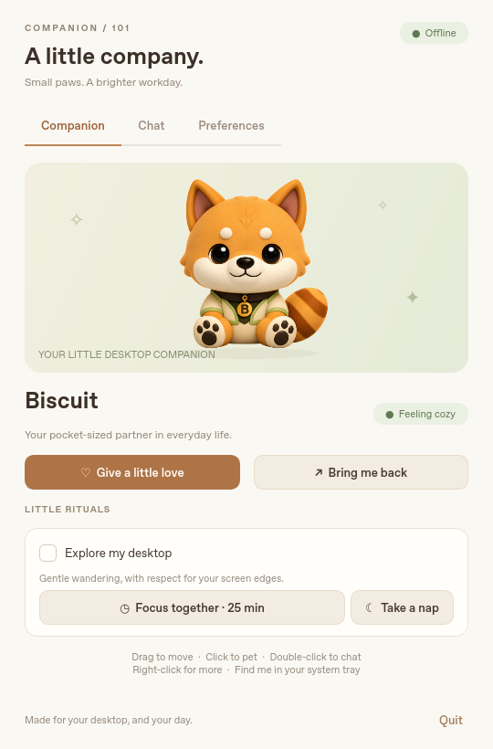

# Biscuit · Companion 101

A real native desktop pet for **Windows 10/11 x64**. Biscuit sits in a transparent, borderless, always-on-top window over your desktop. The app uses **Python + PySide6 / Qt Widgets**, without a browser, web server, or Electron runtime.

The included transparent character sprite was generated using the supplied reference: a plush orange companion with cream cheeks, a striped tail, sage jacket, and a little **B** pendant. It approximates the reference rather than reproducing its original 3D model. One sprite drives procedural animation; individual frame sequences are supported too.



## Start on Windows

1. Install **Python 3.12 x64** from [python.org](https://www.python.org/downloads/windows/), with the Python launcher enabled.
2. Download/extract this project into a writable folder.
3. Double-click **`Start Biscuit.bat`**. On first launch it creates a local virtual environment and installs the pinned dependencies. Internet is needed for this installation, then offline mode works without a connection.

Manual equivalent in PowerShell, from the project directory:

```powershell
py -3.12 -m venv .venv
.venv\Scripts\python -m pip install -r requirements.txt
.venv\Scripts\python run_pet.py
```

The companion panel opens on first launch. Closing that panel keeps the pet alive. Use **Quit** in the panel or tray menu to exit. A second launch brings the existing companion back instead of creating another pet. The pet has no taskbar button; its control panel has one.

## Interact

| Action | Behavior |
| --- | --- |
| Drag the pet | Move between monitors; release clamps to the usable screen area |
| Click | Affection animation, floating hearts, and a little reply |
| Double-click | Open chat |
| Right-click | Open the pet menu |
| System tray → Bring pet back | Restore a hidden or click-through pet |
| Explore desktop | Occasional short walks, with edge detection |
| Take a nap / Wake up | Breathing sleep animation and closed eyes |
| Focus together | A 25-minute timer; click again to cancel |
| Preferences | Name, size, reminders, Windows startup, AI connection |

The pet breathes, bobs, blinks, squashes, stretches, sways while walking, dangles when dragged, and animates when appearing/disappearing. Walking currently uses the supplied seated pose with procedural motion rather than invented walking sprite frames. Movement remains on the current monitor until you drag the pet onto another. Windows taskbar space is respected. Position and size survive restarts; disappearing monitors trigger recovery. Click-through requires a system tray and is reset when the pet is summoned. No global keyboard hooks are installed.

The regular desktop always-on-top setting does not place the pet over Windows secure screens or guarantee visibility over exclusive fullscreen games.

## Offline and optional AI chat

**Offline is the default.** It provides friendly, clearly identified preset replies with no network traffic. The pet animation and desktop features do not require an API key.

For open-ended AI conversation:

1. Open **Preferences** and enable **Use an OpenAI-compatible AI provider**.
2. Enter a base URL (for example, `https://api.openai.com/v1`), a model supported by your account, and your API key. The default model is `gpt-4o-mini`; availability depends on the provider/account.
3. Choose whether to remember the key, then **Save preferences**.

An OpenAI-compatible local server can use a base URL such as `http://localhost:1234/v1` and its local model ID, with an empty key if the server permits. Remote endpoints require HTTPS. TLS verification remains enabled, and API redirects are rejected so credentials are not forwarded to another destination. Requests run asynchronously with a 45-second transfer timeout, leaving the pet responsive. Errors appear in chat without exposing provider response bodies.

AI mode sends your message, a companion personality prompt, and up to 20 recent conversation messages to the configured provider. There is no screen capture, microphone recording, file access, or desktop automation. Conversation history is held in memory only. **Clear conversation** discards it. Changing/saving provider preferences also clears the conversation context. Provider fees and connectivity are your responsibility.

The API key is held in memory, or saved with `keyring` to **Windows Credential Manager** if you choose to remember it. It never goes in `settings.json`. Uncheck the remember option and save to remove the stored key. If secure storage is unavailable, the app reports that the key is session-only. Nonsecret preferences use Qt's application-data location (typically `%LOCALAPPDATA%\Companion101\BiscuitCompanion`). Windows startup uses the current user's `Run` registry key; disable it in Preferences before moving/removing the app. No administrator rights are required.

## Build a portable Windows app

On Windows with Python 3.12 x64, double-click **`Build Windows App.bat`**. It installs build dependencies, runs the test suite, builds a windowed executable, and creates:

```text
dist/Biscuit/Biscuit.exe
dist/Biscuit-Windows-x64.zip
```

Distribute the **entire Biscuit folder** or the ZIP, not just the executable. The portable app does not require a separate Python installation. It is an unsigned build; a signed commercial release requires your own Windows signing certificate and release process.

The included GitHub Actions workflow also tests, builds, smoke-tests, and uploads the Windows ZIP when the repository is pushed or the workflow is manually run. This workflow has been supplied, not executed from the Linux cloud workspace. PyInstaller cannot cross-compile a Windows `.exe` on Linux.

## Development and tests

```bash
python3 -m venv .venv
.venv/bin/python -m pip install -r requirements-dev.txt
.venv/bin/python -m pytest -q
QT_QPA_PLATFORM=offscreen .venv/bin/python run_pet.py --smoke-test
```

On Windows use `.venv\Scripts\python` instead. `--smoke-test` bypasses single-instance locking, renders the native widgets, and exits after two seconds. Tests cover animation transitions, screen boundaries, corrupted preferences, native rendering, pet actions, dragging, offline chat, focus completion, clean shutdown, and real async requests against a local mock AI provider, including error responses. They do not call a paid provider.

Linux offscreen tests verify the Qt application logic and rendering. **Windows tray behavior, transparent click handling, multiple physical monitors, logon startup, Credential Manager, and the packaged `.exe` require Windows acceptance testing.** A live paid-provider connection requires your configuration and has not been verified by the mock-server tests.

### Replace sprites

Put transparent PNGs in `desktop_pet/assets/` and edit `sprites.json`:

```json
"walking": {"frames": ["walk-01.png", "walk-02.png", "walk-03.png"], "fps": 10}
```

Every frame should use the same canvas and character alignment, with transparent padding. Use `idle`, `walking`, `happy`, `sleeping`, `dragged`, `entering`, and `leaving` state names. All frames are preloaded and downscaled for rendering. `eyes` contains normalized `[x, y, width, height]` rectangles for procedural eyelids. Set `"eyes": []` if your new art includes its own blink animation. The `canvas` entry documents the source artwork size; rendering follows each PNG's actual aspect ratio. Keep sprite paths inside the asset directory. Rebuild the Windows package after changing bundled assets.

### Layout

```text
desktop_pet/
  app.py       Application lifecycle, tray, focus timer, single instance
  pet.py       Native transparent window, painting, input, movement
  model.py     Procedural animation and offline responses
  panel.py     Native companion/chat/preferences widgets
  ai.py        Async OpenAI-compatible client
  storage.py   Preferences and Windows logon startup
  sprites.py   Sprite manifest and frame loading
  assets/      Character artwork and animation manifest
tests/         Behavior, UI, network, and shutdown tests
Biscuit.spec   Windows portable packaging configuration
```

## Windows release acceptance checklist

- Launch from the ZIP with no Python installed; pet and tray icon appear.
- Transparent corners have no visible rectangle; pet stays above normal windows.
- Click, drag, double-click, sleep, hide, summon, and quit work.
- Enable click-through; recover using the tray menu.
- Drag across differently scaled monitors; disconnect a monitor and confirm recovery.
- Save/restore position, size, and name; launch twice to confirm a single instance.
- Enable/disable logon startup; verify after signing into Windows.
- Save/remove a test API key using Windows Credential Manager, then verify AI chat with your provider.

No Windows binary or live Windows session is available in the Linux cloud environment; these platform-specific checks remain required before calling the Windows distribution release-verified.
